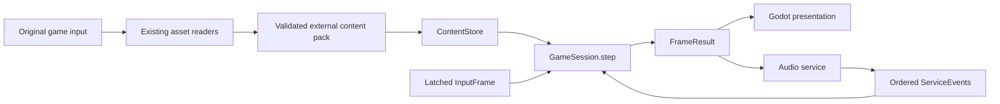

# Phase 3: Godot port

Astra-authored plan, independently reviewed on 2026-10-25 under [[tickets/T-29000-plan-godot-port]]. This page defines the implementation route. The user authorized implementation on 2026-10-25; engine, runtime/oracle and content adapter work is In Progress alongside asset extraction. No playable route or runtime parity is claimed yet.

## Outcome and baseline

Build a desktop game that plays the original Japanese release using the player's original game data, with readable independent gameplay code and a modern engine replacing the PS1 services. Preserve the original rules, scene order, choices and presentation before the later widescreen and translation phases. Layout and string interfaces must already permit longer translated text and different fonts.

Phases 1 and 2 are complete. The port starts from reviewed source revision `182af9d13`, with publication bookkeeping `d7fb33f96` and accepted game/header source digest `687b5ce789d59f154b527264d23227b741a08bc619e4a1f8c67d617257f4c4f3`: 6,952 C functions, 437 logical C basenames, all 27 binaries matching, 2,276,920 bytes. Current source and applied rename ledgers take precedence over proposal-era names in specs. The TT namespace exception remains. Remaining extraction, hardware internals and explicitly unknown meanings do not reopen either completed phase. Evidence: `wiki/status.md`, `wiki/phase2.md`, `wiki/spec/phase2-completion-audit.md`, `docs/adr/0001-phase-2-naming.md`.

The initial deliverable is a bounded playable school-day slice, not a generic engine scaffold. It offers a real command choice, plays an original activity, changes the original stats and reaches the next event boundary. A complete New Game path follows after the shared runtime works. Do not make all assets or every text context a prerequisite.

## Decisions to adopt now

| Area | Decision | Reason and boundary |
|---|---|---|
| Engine | Pin Godot **4.7.2 stable**, standard build, Compatibility renderer. | Official archive checked on 2026-10-25 lists 4.7.2 stable, released 2026-08-18; 4.8 is beta1. Compatibility suits the primarily 2D game and basic 3D without requiring advanced rendering features. Validate custom compositing on this backend before wider rollout. |
| Language | Typed GDScript for game rules, scene controllers, UI and orchestration. | These are small state machines and table-driven decisions; readable source and iteration matter more than native-call throughput. Typed variables, arguments and returns, warnings in CI, and explicit arithmetic adapters are mandatory. No initial C# runtime or direct compilation of matched C into the port. |
| Native code | Add a small C++ GDExtension only for a measured audio/decoder/rendering bottleneck or a required native dependency. | Keep a stable data-oriented boundary so a backend can change without rewriting rules. A native extension is not a second place to put dating or calendar rules. |
| Repository | Keep `port/godot/` in this repository, with independent engine tooling under `tools/port/`. | Source references, data readers and differential tests can be reviewed together. Leave `src/`, `include/`, `config/` and the matching build untouched. A separate repository now would introduce version/ownership friction without proving a benefit. |
| Assets | Original input → existing readers → validated, engine-independent content pack under ignored `.asset-cache/port/` → runtime loader. | No original images, sound, text, scripts, font atlas, extracted tables or executable payload inside `res://`, Git, engine source or release binaries. The Godot project contains code and original project UI only. |
| Fidelity | One explicit native behavior profile, with a versioned list of deliberate deviations. | Preserve observed rule quirks. Do not silently fix thresholds, choice ordering, RNG consumption, malformed text or timing. Later improvements are named policies, testable against the baseline. |
| First platform | Desktop; Linux automated execution, macOS and Windows release smoke tests. | No initial mobile, browser, console, network play or mobile touch redesign. Typed GDScript keeps future options open without promising them. |

Official sources: [4.7.2 release](https://godotengine.org/download/archive/4.7.2-stable/), [release archive](https://godotengine.org/download/archive/), [renderer guidance](https://docs.godotengine.org/en/stable/tutorials/rendering/renderers.html), [typed GDScript](https://docs.godotengine.org/en/stable/tutorials/scripting/gdscript/static_typing.html), [GDExtension class](https://docs.godotengine.org/en/stable/classes/class_gdextension.html). The APIs and release availability are verified; the choice of language/backend is this plan's engineering judgment, not an upstream guarantee of parity or performance.

Before the first engine build, record the official download URL, SHA256 of each engine archive and export-template archive, engine version output, CPU architecture, base-image digest and resulting Docker image digest in `tools/port/godot.lock.json`. Fetch and verify against official release checksums; do not invent a digest in this plan. Build an additive Docker image, reusing existing project/media images for their tools, with separate pinned Godot headless and rendered test paths. All builds, parsers, tests and dependency installation run in Docker. Do not install Python packages or toolchains on the host. A user opening an exported game is distinct from installing a development toolchain. Pin engine upgrades to dedicated tickets with replay and screenshot comparisons.

## Runtime structure and source mapping

The central API is `GameSession.step(InputFrame, ServiceEvents) -> FrameResult`. It advances one native logic iteration. A headless runner and the Godot application both call it. `FrameResult` contains ordered presentation commands, audio intents, state transitions and trace records; it does not expose raw memory pointers. These are proposed port APIs, not existing repository APIs.

Use plain typed, non-Node objects for state and rules. One session owns persistent progression; one active mode controller owns scene execution; services own resource/audio/save operations. Godot Nodes display results and collect input. Signals may notify the UI, but signal delivery order must not decide game rules. Avoid an event-bus framework or an ECS before a concrete need appears.

| Proposed owner | Responsibilities | Source evidence |
|---|---|---|
| `core/game_session.gd`, `mode_router.gd` | Mode, stage, step and substep; exact resets and return contexts; ordered execution. | `src/main/game_mode.c::game_mode_dispatch`, `game_mode_set`, `mode_stage_set`, `mode_step_set`; `src/main/overlay_loader.c`. |
| `core/game_state.gd`, topic state classes | Calendar, player parameters/profile, girls, clubs, appointments, scene flags, day-event queue, persistent system records. | `include/game/game_state.h`, `include/game/day_event.h`, `src/main/game_init.c`, `src/main/memory_card.c`. |
| `rules/calendar.gd`, `scheduler.gd`, `school_day.gd` | Week building, ordered encounter selection, daily effects, week-end health and calendar progression. | `src/main/scheduler.c`, `school_day.c`; `wiki/spec/m-scheduler.md`, `m-weekday.md`. |
| `flow/command_screen.gd`, `scenes/school_day_controller.gd` | Native command eligibility/confirmation and activity sequence. | `src/main/home_screens.c::settings_command_screen_icon_confirm`, `src/main/school_day.c::week_day`. |
| `dialogue/talk_player.gd`, `text_tokens.gd` | Native dialogue state, group/line cursor, control semantics, substitutions, choice identity, voice gates. | `src/main/scene_library.c::talk_run`, `talk_speak_part`, `talk_render`; `text_system.c`; existing `tools/assets/text*.py`. |
| `presentation/scene_composer.gd`, `sprite_sequence.gd` | Native layer order, logical coordinates, palette/part composition, sequence advancement and completion. | `frame_render_audio.c`, `actor_sprites.c`, `gpu_primitives.c`, `screen_layers.c`; `wiki/spec/h-graphics.md`. |
| `services/content_store.gd`, `audio_service.gd`, `save_service.gd` | Validated data access, deterministic playback lifecycle, versioned saves. | Reader manifests; `sound_driver.c`, `memory_card.c`, `wiki/spec/m-dates-a.md`. |

Split `GameState` into domain records rather than reproducing the entire PS1 RAM layout. Preserve stable numeric IDs and original enum values at data/trace interfaces. Keep unknown but persisted fields as named opaque fields with evidence references until understood. Mappings from raw addresses to semantic fields belong to import/debug adapters only. Do not substitute UI indices for girl, command, place or original choice IDs.

Use a persistent application shell, a gameplay viewport, a scene presenter, and UI Controls for HUD/dialogue/menus. The scene router maps original modes to controllers, but an overlay is a content/module boundary, not necessarily one Godot scene. Related DATE/GEKO/seasonal controllers can share portrait/dialogue presenters while retaining their own state and rule logic. Do not convert 6,952 functions into Nodes. Preserve borrowed-mode return contexts (including the caller's chosen next stage/step) from the source rather than relying on engine scene-stack behavior.

The game has two distinct forms of interpreted content. SERIFU data uses parallel `text[group][line]`, `command[group][line]`, `voice[group][line]` tables. Scene step tables in C select native callbacks and predicates. Port the latter to a registry of typed operations with explicit wait results; do not pretend all scenes are SERIFU scripts or treat script control bytes as generic narrative markup. Extract table data from the user's original inputs and retain source locators; implement their behavior in readable port code. Unsupported operation, unresolved mandatory asset or unknown reachable branch stops the development route with a precise diagnostic and resumable checkpoint. It must never silently advance a line, discard an encounter or award an invented result.

## Arithmetic, clocks, input and randomness

GDScript integers are signed 64-bit, whereas this game's widths and promotions affect results. [Official integer documentation](https://docs.godotengine.org/en/stable/classes/class_int.html). Implement a small audited `core/native_math.gd`: `u8/s8/u16/s16/u32/s32`, wrap-on-write helpers, signed and unsigned comparisons, logical versus arithmetic right shifts, and division/remainder with the original truncation semantics. Keep fixed-point parameter words as integers. Preserve the order of multiplication and division; do not combine terms algebraically. Handle a 32×32 product through limbs or otherwise proved low/high-word operations where a signed 64-bit intermediate would overflow. Resolve signed-overflow, oversized-shift and division-edge behavior from original instructions, not undefined-C assumptions. Reject an unsupported numerical operation rather than falling back to floats. Unit cases must cover sign boundaries, narrowing, negative dividends, the minimum signed value and intermediate overflow.

This matters immediately in `parameter_up_down`: positive gains scale by holiday, poor-result, sickness and restriction divisors, negative changes take a different path, stress adds a separate term, and parameters use shifts by 12. Preserve K&R narrow unsigned promotion where relevant; `CODING_STANDARDS.md` section 2 explains the matching ABI. Use float only after state is determined, for display interpolation. For later 3D/mini-game fixed-point sine, angles and collision math, preserve original tables/rounding rather than trusting engine physics or trigonometry. Import those tables from original input; do not commit a payload copy.

The first activity also requires `hud_screens.c::hud_command_roll_poor_result` and `hud_panels.c::parameter_change`, not just `school_day.c`. Preserve their fractional words and clamp sites: `parameter_change` can clamp the high halfword while retaining the fraction, whereas `scene_library.c::check_para_limit` has whole-word assignments on some limits. A generic floating-point stat clamped to 0–999 would lose this distinction. Include both boundary behaviors in the arithmetic/oracle packet.

Maintain separate counters for native vblanks, logic iterations and rendered frames. Nominal school-day cadence is 60 iterations/second; do not claim an exact NTSC fractional rate or that all modes have this cadence without measurement. `frame_render_audio.c::draw_frame` has a different wait path for shooter mode 0x90, so its vblank-to-iteration ratio needs its own trace. Use a fixed-step accumulator with an explicit rational timebase and direct stepping for tests. Godot `_process(delta)` drives the accumulator, never parameter changes. Do not equate `Engine.max_fps` with logic frequency; the engine documents separate render and physics controls. [Engine timing API](https://docs.godotengine.org/en/stable/classes/class_engine.html).

Preserve the observed phase order. `main_loop.c::boot_loop` dispatches the active mode, increments `frame_count`, then calls `draw_frame`, CD work and audio work. `draw_frame` advances actors and polls input after mode execution. Thus input gathered at that boundary is used by the following mode iteration. The port must represent this latch explicitly. Trace timer updates, mode timer post-increment and stage/step reset ordering before declaring parity; do not increment every timer generically. An accumulator may process several steps, but must not consume a single press twice. Under a long stall, retain pending steps or pause/resync services; do not drop simulation time while audio keeps running unchecked.

Separate physical loading from game-visible readiness. Prefetch the route's dependencies, pause virtual time if the host cannot supply a required resource, then deliver readiness only at the defined service phase. Differential replay uses the captured completion schedule, including waits that ran animation or RNG updates. The live desktop policy may shorten pure loading waits, but that is a declared adaptation with deterministic logical readiness, not a claim that real CD latency is reproduced. Never collapse waits with observable game-side work. Do not treat one captured seek delay as a universal constant. Stochastic parity is claimed for the same initial state, input and service-completion schedule; variable host I/O must not become an unrecorded random input.

Implement controller and keyboard mappings through Godot input actions, then create immutable tick-stamped held/pressed/released snapshots. Reproduce menu repeat, confirm/cancel, mouse conversion and double-click rules from `pad_input.c`, `mouse.c` and menu helpers; OS key repeat is not the game timer. Original circle/cross semantics are the native default, with remappable physical controls. Add mouse focus/hit testing in the same logical coordinate space; remapping must not alter game rules. On focus loss, pause the port clock and playback together and clear stale edge state. This is an explicit desktop adaptation. Soft reset can be a deliberate command/chord, not an accidental exit path.

Use an explicit saved native RNG state; do not call Godot's random functions for original gameplay or animations. `main_loop.c::timer_tick` increments both `timer_ticks` and `system_data.seed` (+0x377); title seeds `srand(timer_ticks)`, while file select seeds from `system_data.seed`. Those counters are not automatically the libc RNG state. Recover and test the actual SDK `rand`/`srand` implementation at symbols 0x800AE0D0/0x800AE120 and any overlay-local generators (RPG has its own helpers). The algorithm and first golden stream are an immediate evidence spike, not guessed constants in this plan.

A blink may consume the same RNG stream as a later encounter. Preserve original cosmetic state updates and RNG draws at native ticks even when rendering is hidden, interpolated or headless. Moving rendering to a GPU does not require emulating VRAM, but it does require keeping the small actor/animation simulation that affects future state. Purely new visual flourishes, if later approved, get a separate stream. Trace RNG caller ID, pre/post state and result. A deterministic replay records the starting seed state and all external inputs/service completions, not merely a timestamp. Boot loading times can legitimately change initial seeds; compare captured boundaries first and define seed capture for real New Game before claiming start-to-end deterministic correspondence.

## Content import and version boundaries

Reuse `tools/assets/input.py::open_input`, `tools/assets/manifest.py`, the text exporters, `media_ui_export.py`, `media_mdec_export.py`, stream decoders and music/bank exporters. The generic `tools/export_assets.py` alone does not cover all newer cohorts. Create a thin `tools/port/import_content.py` orchestration/adaptation layer; do not fork decoder logic into Godot. The input wrapper already supports extracted directories, MODE2/2352 tracks and ZIP-contained tracks. A plain directory cannot supply every raw-sector/audio dependency; report the precise missing input capability.

The first importer accepts the verified SLPM_86.053 release and validates its inventory/hashes. Other releases require explicit profiles. The user wants all known PS1 releases supported eventually (not other platforms); [[tickets/T-29017-support-ps1-releases]] tracks the version-specific content audit and verification. Recognizing a disc is not equivalent to supporting its complete runtime content. Original files are read-only. Outputs go to a new immutable directory `.asset-cache/port/<content-id>/`; publication follows validation, and a failed import does not modify a previously working pack. Reuse path/symlink containment, bounded reads and no-overwrite safeguards already present in `manifest.py`. Runtime paths are relative to an approved external pack root and checked for escape. Treat the pack as data; do not load executable scripts or object-deserialization payloads from it.

Add proposed schema `tokimemo.port-content.v1`, composed from accepted media/text schemas rather than replacing them. Manifest fields include original inventory/hash IDs, reader/source revisions and source digest, component schema versions/hashes, import options and decoder versions, semantic logical IDs, source locators, asset hashes/sizes, image geometry/parts/palettes/masks, sequence timings, audio clip metadata, script references, data-table references and feature capability lists. Record uncertainty/status per resource: verified, approximation, unresolved, unsupported. Capability validation is per route, not the percentage of the whole corpus exported.

Identity must distinguish canonical physical image cell, palette variant, display part and use-site alias. Consume the asset team's reviewed canonical-cell fix when published; do not freeze the old ambiguous prologue `.cell-N` identity or invent a parallel correction. Similarly, reject held VAB mapping output until declared-size validation is fixed. Pin exact exporter commits and manifest hashes when a slice is accepted. Do not assume that a `.v1` schema label proves the same asset profile revision. New schema versions need explicit adapters; unknown versions fail with a useful message.

Godot loads external PNG/data/audio through runtime loading, with a bounded cache and preflighted scene dependencies. `Image`/`ImageTexture` and `AudioStreamWAV.load_from_file` are suitable initial APIs; do not depend on Godot editor import artifacts for original content. [Runtime loading](https://docs.godotengine.org/en/stable/tutorials/io/runtime_file_loading_and_saving.html), [WAV API](https://docs.godotengine.org/en/stable/classes/class_audiostreamwav.html). Keep `.godot/` and exports ignored. Release source/player packages must contain no original content. User clarification (2026-10-25): the shipped player must ask for the original game on first launch, invoke a packaged importer, validate and store assets in persistent per-user application data, and reuse those assets on subsequent launches without the original present. Build and test the importer in Docker; end users must not need Docker, Python, dependencies or the editor. Provide progress, cancellation, atomic publication and repair/re-import while preserving saves and the last working pack. Development exports remain under ignored `.asset-cache/port/`; production installation roots are explicit external application-data paths. Track implementation in [[tickets/T-29016-first-launch-original-import]].

Source-derived initial values, calendar/girl tables, native text and script operands are also original data. Load them through the content boundary instead of duplicating large literal arrays in GDScript. Keep algorithm constants and enum meanings in code, with source witnesses. Commit synthetic fixtures only. Golden screenshots, state captures, decoded audio and real exported fixtures remain ignored; public tests commit recipes, schemas and expected hashes where appropriate.

## Text, Japanese presentation and future translation

User direction (2026-10-25): Gemini owns the translation pipeline, including translations of text baked into images and suggested wording/layouts that fit the original image dimensions (icons and similar UI art). Preserve those suggestions with their asset identities for Phase 5. Creating and integrating translated images is later-phase work; do not create replacement art now or change Gemini's pipeline or editable translations. The port and extraction work should retain the source dimensions, palette/transparency and placement metadata needed to apply those replacements later.

Keep four layers: original bytes/locators; decoded control and glyph tokens; dialogue state/meaning; displayed layout. Strict Unicode decoding is a reference view, not the authoritative replacement for native glyph identity. `text_font.py` already maps code units to the original 3,418 12×12 1bpp glyphs; extend its consumer into an ignored local atlas rather than declaring every source code Unicode-equivalent. Unknown codes and renderer-error cases remain explicit. `assets-text.md` documents original malformed tabs and differences between strict Shift-JIS and CP932; neither a replacement character nor stripping bytes is an acceptable silent repair.

Implement `talk_run`/`talk_speak_part` command semantics with their caller contexts. Preserve 0xFF group termination, name/context buffer substitutions, source choice count and runtime permutation, automatic/clear/wait states, voice cancellation, speed and reveal behavior. A `q` variant separator is not an English line break. Inline speaker prefixes, conditional suffixes and generated birthday/blood-type answers need typed nodes, not regex cleanup of a display string. Player and heroine identity remain game state, not translated text keys. Separate native name codes from display strings so future longer names do not require fixed PS1 buffers; Phase 3's normal entry UI keeps its native constraints, while any native save import/export has an explicit encoding/length policy.

The 43-line NAME_ENT prologue uses its own line player and voice tables, including a second clip at line 19. Do not force it through generic SERIFU behavior. `src/ovl/name_entry/prologue.c::prologue_line_start`, `prologue_line_run`, `prologue_mode_handler`; `wiki/spec/o-nameent.md` section 5. Preserve the wait for voice start, completion/second-clip conditions, text completion and 0x3D-frame hold, including START's source-defined skip to stage 21. Lip animation uses CD-level history; derive a deterministic signal from validated clip data or a proved level trace, never from the host's master volume meter.

For Japanese fidelity, use native glyphs, source line boundaries and original viewport layout. Architect a second layout policy for shaped Unicode fonts, width-aware wrapping, variable textbox height, pagination, scrollable/expanded choices and independent speaker plates. A synthetic long-string stress test belongs in Phase 3; translated content does not. Logical line/choice completion is distinct from visual wrapped rows, so a translation can exceed PS1 byte or box limits without changing a branch or voice identity.

Future translation packs are keyed by existing stable text-unit IDs plus original source hash and context, with locale, revision, translator/provenance, review state, named placeholders, choice option IDs and optional layout hints. Keep controls and timing as structured metadata; translators edit text, not executable game opcodes. Missing/unreviewed entries fall back to original Japanese. Validate placeholder/choice preservation and stale source hashes. Existing JSONL/TSV is the exchange base; a PO/CSV editor export can be added without making literal source strings the identity. Godot's localization facilities may serve project UI; the content resolver remains explicit for the external game pack. [Localization and named placeholders](https://docs.godotengine.org/en/stable/tutorials/i18n/internationalizing_games.html). No fan-patch translation or implementation is copied. Later English work must keep the roadmap's AI disclosure and human-replacement provenance.

## Rendering, animation and audio

Start with a 320×240 logical canvas and the source's centered coordinates translated at one boundary; scale and letterbox it in a resizable window. `game_init.c::gpu_init` establishes the base dimensions. Keep source geometry separate from viewport fit: the accepted school-day backgrounds are active 320×88 regions, not full-screen pictures. Their two display pieces and runtime origin must be resolved in the first visual spike. Native image data plus a PNG gallery does not yet prove the scene's placement.

Use textured quads/sprites and explicit layer order. Retain raw indices, CLUT values and bit-15 masks where palette animation or semitransparency needs them; do not flatten everything to one RGBA texture and lose future palette behavior. Replace texture-page/VRAM addresses with semantic handles and resident resource groups. Model invalidation when the original reused content affects the scene, but omit CD sectors and physical texture pages from gameplay APIs. Part composition, sequence commands, flips, clipping and completion events belong in the native presentation simulation. `image_packs_sd.py` exports static frames and parts; complete animation composition is still a bounded implementation task.

Implement palette changes, fades and blend modes only as encountered, with reference images. A shader/subviewport or ordered software compositor may be needed for PS1 destination-dependent blending; test the exact modes used by the slice before choosing a whole-game strategy. Nearest filtering and no mipmaps for native pixel art are the initial display policy. Do not promise pixel-perfect MDEC color: current software IDCT/RGB555 export is explicitly approximate. Compare geometry, masks and ordering separately from that documented color tolerance.

Later title models and TACO use a dedicated 3D presenter. Preserve gameplay transforms/collision math and source camera behavior; do not substitute Godot rigid-body physics. Projection, texture precision and drawing-order effects need reference captures. Wider backgrounds, expanded camera framing, redesigned HUD and replacement image text stay in Phase 4/5. The Phase 3 layout separation prevents a rewrite later without stretching 4:3 art now.

Audio has three explicit lanes: decoded XA/CDDA/movie streams; effects with proved tone/sample mapping; sequenced BGM. The audio service accepts logical commands and emits started/ended/cancelled/error events on the session's chosen tick boundaries. It stores playback cursors for saves/replays. Mute changes audibility, not command completion or story timing. Async device callbacks enter an ordered queue; they never mutate rules directly. Headless tests use recorded or deterministic sample-clock events. Live playback uses sample counts plus measured mix/output latency, with drift handling. Godot exposes latency and playback clocks, but its synchronization tutorial flags that parts await a 4.7 update; verify the integration on 4.7.2. [AudioServer](https://docs.godotengine.org/en/stable/classes/class_audioserver.html), [audio synchronization](https://docs.godotengine.org/en/stable/tutorials/audio/sync_with_audio.html).

14,910 WAV groups and 997 movie frames are inventory/export results, not established mappings from every runtime request to a complete clip. Bind each needed clip's source selector, channels, extent, rate, duration and interruption behavior. Movie playback requires ordered frames, source cadence, sound synchronization, crop/placement and skip semantics. Use an offline converted standard stream or a frame-stream presenter after that evidence; do not feed a folder of frames into an arbitrary FPS video and call it faithful.

For BGM, the native sequencer timing and command routing remain the authority. Current 63 SEQ packages / 177 streams / 337,797 events and MIDI auditions do not establish exact playback. Native MPQN is proved; bank assignments, event scheduling, envelopes/pitch/loops and runtime use still need proof. Never select banks by matching stems, use General MIDI instruments, or assert a guessed sample rate is original. The held VAB declared-size bug is a direct blocker for trusting that mapping, not for writing game rules.

Default progression: implement the command/event interface first; use verified PCM for XA and any fully proved static effect. For a fixed BGM route, an offline render from a validated native sequence+bank+driver initialization may serve as a temporary backend, retaining loop/stop/fade semantics and a declared fidelity status. Full Phase 3 audio acceptance requires the reachable command behavior, including changes that a static render cannot reproduce. If those require runtime synthesis, implement a deterministic native sequence/sample backend behind the same interface; use C++ GDExtension for audio-rate work rather than sample-by-sample GDScript. Decide the exact synthesis implementation/library after the bank/driver spike, checking its source license and reproducible Docker build. Do not hold the first playable activity for this, but label missing BGM/effects plainly and do not mark full audio fidelity complete. Silent development operation must still model proved timing; missing voice required to advance a route is a blocker unless a verified timing backend is available.

## Save/load, versioning and compatibility policy

Use a versioned semantic save format, not a serialized Godot scene or a PS1 RAM dump. Separate progression saves, persistent system/clear/album data and user preferences. Include save schema, behavior-profile version, game source digest, content-pack identity/component hashes, logical checkpoint, RNG and virtual clocks, queued events and all owned state required to resume. Preserve original fixed-point values. Encode integers canonically without accidental JSON float round trips; 64-bit counters use validated decimal strings if JSON is chosen. Save checksums detect corruption, not authenticity.

First support saves at explicit stable boundaries (command screen and completed day-event boundary). Suspend-anywhere is deferred until interpreter, animation and audio continuation state can all be restored. Write temporary files then atomically replace the chosen slot, retaining a last-good backup. Validate fully before replacing live state. Test corrupt/truncated files, missing packs, unknown schemas and interrupted publication. Migrations explicitly convert old save formats to new ones with fixtures and backups; a newer unsupported schema is refused. Presentation-only pack changes may be compatible if logical IDs and behavior hashes agree; do not invalidate every save merely because a preview PNG changed.

Original memory-card import is a later adapter using `memory_card_bank_validate`, `memory_card_game_bank_load` and `GameSaveImage`, with checksums, album-bank selection, profile and system-file semantics. `memory_card_game_bank_build` saves selected fields rather than the whole state and does not itself supply a portable live RNG snapshot; do not promise an imported save recreates the original future random sequence. Start at the source-defined load boundary, recording the port seed policy. Never write back to the user's original card image. Exporting PS1-compatible saves is a non-goal for initial Phase 3.

Native rules are the default even when odd (for example the source name-entry random blood-type range excludes O). A behavior-changing fix requires a defect record, source/emulator evidence, an explicit compatibility-policy version and regression comparison. A memory-safety fix may replace an invalid access with a diagnostic without pretending it is native behavior. Better desktop resizing, remapping and focus-pause are permitted adaptations, each recorded separately from simulation fidelity. No silent corrections to original data or hidden alternate balancing.

## First playable slice: command to first school-day result

Start from an original-data-backed boundary snapshot at `GAME_MODE_COMMAND_SCREEN` (0x34), stage 0xFF after prologue, then run the genuine source flow. This development entry bypasses boot, title, memory-card screens, name entry and the voiced prologue; it is not a complete New Game feature. The snapshot is generated by a reproducible emulator/input recipe and kept ignored. A known profile may also be produced by the independently ported `boot_game_data_init`/name-entry setup once those are proved. Do not replace it with hand-invented production defaults.

Initial supported command choices: liberal arts (0) and rest (7), subject to actual `get_icon_can_use` rules. Capture both from the same valid state/seed; resolve any reachable companion/encounter branch before accepting that route. Select an ordinary non-special boundary from reproducible play if the immediate first-school-day branch has unsupported dependencies; record the exact date/seed/path, not a claim that all fresh starts are covered. Unsupported choices are clearly unavailable in the development launcher, with no changes to original eligibility calculations.

Exact intended path and semantics:

1. `home_screens.c::settings_command_screen_mode_handler` / `settings_command_screen_icon_confirm` accepts the selected command, writes `last_command` and enters 0x30. Implement the native latch/order and the necessary room/HUD assets.
2. `scheduler.c::_schedule_init` runs `schedule_step_prepare`, `day_event_queue_build_week`, `schedule_girls_gakko`, `schdeule_girls_param`, then `schedule_step_advance_day` in source order. The weekly queue is real, even though this slice displays only its first supported school day. Port all executed branches and state mutations; do not fabricate a one-record queue and call the scheduler complete.
3. `schedule_step_advance_day` advances the calendar and enters 0x31. `day_event_dispatch` consumes the real ordered queue and routes a school-day record to 0x40. Record an unsupported event as a boundary failure rather than skipping it.
4. `school_day.c::week_day` performs setup, activity and exit. `school_day_sd_set_select` and actor setup choose original sprites; sequence execution supplies the completion signal. `week_day_main0` applies `parameter_up_down` exactly once when animation state permits, with the poor flag and source 14-iteration result hold / 601-step timeout behavior. Test both normal completion and timeout. `week_day_exit0` increments the queue index, clears actors and returns to 0x31.
5. Present the resulting date and parameters, save a boundary checkpoint, and offer replay from the captured starting boundary. Stop before the next unimplemented queue record. This is a bounded playable build, not a claim to support an ordinary week or the entire opening.

Required original content is narrowly enumerated by the route: initial/profile/calendar and command-delta data; room/HUD/icon/font assets; selected `C_01_27.BS`/appropriate rest background according to actual selectors; selected weekly SD pack(s), parts and sequences; labels and necessary sound-command metadata. Do not assume command 7's background from a filename: follow `school_day_background_read`/`get_weekly_bg_sector` and current state. Existing SD and reviewed school-day background exports provide much of this, while runtime origin/animation sequence semantics still need work. All required asset IDs are emitted by route preflight into an ignored dependency report before coding the presenter.

Acceptance evidence:

- A person can choose both supported commands, see original imagery/animation/HUD, observe different correct parameter effects and save/reload the boundary. Placeholder rectangles alone do not pass rendered acceptance.
- Per-boundary differential traces match original mode/stage/step, day/date, full relevant fixed-point parameter words, queue records/index, girls' affected values, RNG state/call sequence and command selection. Compare intermediate mutations to locate the first divergence.
- Replaying the same capture/input/service schedule headlessly, at 30/60/144 rendered FPS and with rendering disabled produces the same ordered state hashes and presentation intents. Rendering frequencies are test conditions, not altered game rates.
- Sample captures cover selection, activity start, result and exit. Check layer/part positions, palette/masks, animation sequence and text glyphs. MDEC color tolerance is named and bounded; no blanket screenshot tolerance hides geometry errors. Rendered tests run Godot with a real software/GPU rendering backend under Docker (for example Xvfb + Mesa), not `--headless` dummy rendering.
- A required missing/corrupt asset, wrong pack version, unsupported event and unsupported command each produce a precise failure without progression mutation. Save/reload yields the same continuation as uninterrupted stepping.

The oracle is the original executable under the existing Docker PCSX-Redux/OpenBIOS tooling, not a second translation of the same formula. `tools/emu/run.sh` supports symbolic breakpoints, frame inputs, dumps and screenshots; `wiki/emulator.md` documents the limits, including BIOS timing differences. Reuse it and add bounded trace/projection tooling under `tools/port/`, resolving current symbol names and qualifying overlay hits. Keep emulator outputs in their existing ignored directory or copy selected derived evidence to the ignored port test cache. Commit no screenshots or save states. Numeric unit fixtures supplement the oracle; they do not replace it.

## Milestones in dependency order

| Milestone | Work and dependency | Acceptance / exit condition |
|---|---|---|
| P3.0: contracts and evidence | Pin engine/tool images; standards scope for port; content adapter schema; native math/RNG/input/tick trace; capture route entry and dependency manifest. | Synthetic tests run with no game input; real route preflight reports exact missing capabilities; original trace and verified RNG stream exist. No engine source or original data modified. |
| P3.1: first activity | Implement the bounded command→scheduler→school-day path above, original presenter, stable-boundary save/load. | Both command routes pass deterministic, differential and rendered criteria. Missing audio fidelity explicitly reported. This is the first playable delivery. |
| P3.2: ordinary week and a conversation | Expand required weekday commands, calendar/week-end/holiday/room behavior and a source-reachable GEKO encounter with a real choice and correct relationship effect. | One complete ordinary week returns through its proper boundaries; normal/poor/sick/vacation rules have targeted differential cases; encounter choices, substitutions and voice-off/on behavior pass. Unsupported future modes still stop explicitly. |
| P3.3: New Game and voiced prologue | Port profile entry/new-game rules, prologue, title/start routing and native save slot UI adapted to desktop storage. Add the complete source asset/clip dependencies for this route. | Start without a captured state, enter Japanese names/profile, play/skip prologue correctly (including second clip), reach the already-tested command loop, quit/reload. Title/attract movies and model behavior are tested before claiming complete opening fidelity; a temporary functional start menu is labeled interim. |
| P3.4: full calendar/story routes | Telephone/date and encounter families, annual/school events, club activity/mastery, exams/career, endings/clear data/album. Integrate in reachable calendar order and one complete route at a time. | First a full three-year route to an ending; then targeted scenario matrix covers all reachable event families, heroine routes, conditions and endings. No requirement to brute-force every possible playthrough. Trace rare branches from source-designed state recipes. |
| P3.5: interactive subgames and remaining media | Sports, festivals/stalls/stage shows, camp/practice, RPG, TACO, TT; complete reachable audio/movie/3D behavior. Work can start earlier behind stable contracts. | Per-module entry/return context, result effects, collision/input timing and media behavior match documented scenarios. Shared RNG remains stable. No advanced mini-game collision routed through unverified Godot physics. |
| P3.6: Japanese desktop acceptance | Reachability/coverage audit, fixes, performance, save migrations, clean import/export/package smoke tests on desktop targets. | New Game→all shipped reachable mode families→endings/clear-save/album are covered by reviewed recipes; no unresolved mandatory content on supported release routes; no silent fallback; no original content in source/player package. Publish a precise remaining fidelity-deviation list. |

P3.4 and P3.5 may proceed in parallel after the shared runtime is stable; P3.6 waits for both. Full Phase 3 completion includes reachable mini games and soundtrack behavior, not just an ending route. EVENT/GYOZI development copies are not automatically features: current loader evidence does not load them (`game_mode.c`, `overlay_loader.c`, `wiki/spec/m-flow.md`); preserve reference material but do not add dormant routes. The TT folder/naming exception does not excuse omitting its reachable behavior. Phases 4 and 5 remain separate: widescreen/UI modernization first, then translated content and image-text replacement. No completion dates are promised.

## Asset dependencies by milestone

| Current uncertainty | Immediate effect | Does not block |
|---|---|---|
| School-day draw origin and SD sequence/part semantics | Original rendered P3.1 activity acceptance until the selected packs are composed/timed correctly. | Math, state, trace, save and importer work. |
| Font/glyph runtime differences and 1,861 unclassified executable/overlay text extents | The specific reachable UI/dialogue routes needing those entries; broader localization acceptance. | Known labels/scripts and unrelated gameplay. 55,403 exported rows are neither all ready nor missing main dialogue. |
| SPEAKTST 16,702 conditional candidates with unproved runtime roles | Sound-test or routes that actually require them; do not load all as dialogue. | Normal SERIFU dialogue and first activity. |
| Prologue NBN identity repair plus unresolved geometry/placement/timing | The affected composite prologue screens in P3.3. Consume the team's reviewed fix; do not duplicate it. | P3.1/2 content outside those packs. |
| VAB declared-size correction, null runtime bank assignments, sequence scheduling | Exact affected effects/BGM and full soundtrack acceptance; some routes may need event-duration proof even while muted. | Rule code, image rendering, known XA decoding, bounded first activity with disclosed missing sound. |
| Complete XA clip mapping / movie cadence and placement | Voiced route completion and particular movies/attract scenes. | Voice-off dialogue paths where the source supports them; normal school-day progression. |
| Remaining 73 NBN sources / 227 BS geometries in the current accepted census | Only milestones that reach those files, then whole-release coverage. | Starting Phase 3. Counts are a snapshot, not an engine prerequisite. |
| Approximate software MDEC color / unproved PS1 blending | Exact-pixel claims for those images/effects; use separate documented comparison tolerances. | Geometry/timing/rule fidelity and an honestly labeled playable build. |

The existing 31,346 ready / 24,057 flagged text counts and 3,488-region image census are reporting context, not universal acceptance criteria. A route manifest must prove its own runtime uses. All 29,403 fan-reference dialogue offsets are already covered by the local offset inventory; do not plan a new hunt for supposedly missing main dialogue or copy fan material.

## Ready implementation tranche and ownership

Implementation tickets below define these bounded packets; each owner pins its inputs before work. This planning ticket does not grant workers a shared-source write lease. Existing text/media teams retain ownership of `tools/assets/`; port workers request missing capabilities through those owners. Root serializes integration and wiki/Git changes. Use cheaper agents for bounded implementation and ordinary reviews, escalating only a concrete unresolved timing/math/render/audio problem. Every ticket reaches In Review before Done and records standards review plus its actual evidence.

| Packet | Exclusive proposed paths | Testable deliverable / dependency |
|---|---|---|
| A: engine and project contracts | `port/godot/project.godot`, `port/godot/PORTING.md`, `tools/port/{Dockerfile,godot.lock.json,run.sh}`, `port/godot/tests/run_tests.gd` | Pinned 4.7.2 smoke/import/headless test runner, separate rendered test invocation, source/assets exclusion checks; standalone synthetic run. Coordinator owns root build/docs changes. |
| B: native behavior and oracle | `port/godot/core/{native_math,native_rng,native_clock,input_frame,game_state,game_session,mode_router}.gd`, `tools/port/{capture_route,compare_trace}.py`, `port/godot/tests/core/` | Verified RNG/arithmetic, original projected boundary trace and replay schema; synthetic boundary tests plus local original oracle. Freeze `GameSession.step` and result types before others integrate. |
| C: content adapter | `tools/port/{import_content,validate_content}.py`, `tools/port/schemas/`, `port/godot/services/content_store.gd`, `port/godot/tests/content/` | Original-input route pack without copied decoder code; stable logical IDs, component/version/hash validation, corrupt/missing/escape tests; synthetic fixtures only. Existing asset owners supply fixes. |
| D: playable rules/controller | `port/godot/rules/{calendar,scheduler,school_day}.gd`, `port/godot/flow/command_screen.gd`, `port/godot/scenes/school_day_controller.gd`, `port/godot/tests/rules/` | Two source-valid command routes with complete executed branch effects; parameter and queue differential cases. Depends on B state/math and C tables. |
| E: original presentation/input | `port/godot/presentation/`, `port/godot/ui/`, `port/godot/app/`, `port/godot/tests/render/` | Original room/activity composition and glyph HUD, real keyboard/controller choice, tick-driven sequence completion, native layers/masks; render comparisons. Depends on B interfaces and C pack. |
| F: save/audio service boundary | `port/godot/services/{save_service,audio_service}.gd`, `port/godot/tests/services/` | Atomic boundary save/restore, deterministic service lifecycle, validated available stream playback and clear missing-feature status. Depends on native runtime and content; no invented BGM mapping. |

With limited parallel slots, run A/B/C first (A can be small coordinator work), then D/E/F. No two workers own the same state/schema files. Before expanding to overlays, review the interface on the working slice and remove abstractions that have no caller. Proposed future tests include `test_native_math.gd`, `test_native_rng.gd`, `test_mode_order.gd`, `test_content_pack.gd`, `test_school_day_trace.gd`, `test_save_resume.gd` and `test_native_composition.gd`; names describe intended behavior, not tests claimed to exist. A plain Godot `SceneTree` test runner is enough initially; pin an external test framework only if it provides a demonstrated benefit. Headless execution is officially supported via `--headless`; it does not validate pixels. [Headless Godot](https://docs.godotengine.org/en/stable/tutorials/export/exporting_for_dedicated_servers.html).

Add a scoped port standards document before code: typed GDScript style, domain names from `GLOSSARY.md`, dependency direction, deterministic arithmetic/state, source witnesses, unsupported handling, synthetic public fixtures and no content in commits. Existing C89, SDK ABI and byte-matching constraints continue to apply to the decompilation; they are not reasons to force GDScript into C syntax. Port-only changes require a protected-file/source-digest check, not a costly 27-binary rebuild on every UI edit. Any actual decomp/build/config change still follows `rename.py` and the existing clean 27/27 gate. Retain ticket IDs, small focused commits, review, wiki/log and no-copyrighted-payload rules everywhere.

## Bounded evidence spikes and remaining decisions

1. **Native RNG and clock boundary.** Recover actual SDK RNG, seed locations, input latch, vblank/iteration order and two command-route traces. Exit with known-answer streams and a first-divergence comparator. Blocks P3.1 parity, not starting the engine/content work.
2. **School-day visual completion.** Prove selected background origin and every SD sequence operation exercised by both routes; map its completion bit to `week_day_main0`. Exit with original/native and port composition traces plus rendered comparisons. Blocks rendered first-activity acceptance.
3. **Route closure.** Choose and record the original captured boundary and verify all branches for command 0/7. If a companion/encounter is unavoidable, include that exact handler or select another reproducibly reached ordinary boundary; never delete it from the queue. Exit with a finite dependency/branch list.
4. **Voice and music services.** After existing asset fixes, prove one XA request end-to-end and one BGM route's sequence/bank/tempo/command behavior. Exit with sample/tick timing and a decision whether that route permits offline rendering or needs runtime synthesis; no full-corpus demand.
5. **New Game closure.** Resolve original name glyph entry, profile initialization and prologue dependencies, including long-lived effects and line 19. Exit with a complete start-to-command path and explicit title/attract coverage.
6. **Later 3D/cadence.** Before TACO/title completion, prove mode-specific timebase, transforms and collision/ordering behavior. Exit with narrow tests rather than a speculative general PS1 GPU emulator.

No current decision requires stopping to ask the user. Language, folder, renderer and first slice are reversible recommendations. Later user-facing choices include default modern typography, widescreen framing, arbitrary longer names, suspend-anywhere and bug-fix preferences; they do not block the Japanese native profile. A platform-specific native library/signing/distribution decision can wait until it is concrete.

The largest uncertainties are execution-context gaps in data, interleaved RNG/timing, animation/compositing semantics, bank/driver audio behavior, and the number of exceptional branches needed for full three-year coverage. Matching C is strong evidence but not automatically a clean platform-independent specification. Keep the original runnable as the oracle, accept routes incrementally, and report supported behavior at every playable delivery. Do not promise that extracted previews, MIDI files, or one successful ending prove the whole port.

## Implementation tickets and start order

Start [[tickets/T-29001-godot-engine-foundation]] first. Native-oracle evidence in [[tickets/T-29002-native-runtime-and-oracle]] and Python content-pack work in [[tickets/T-29003-port-content-adapter]] can run alongside it; their engine integration and Done gates still require the foundation. The playable controllers, original presentation and save/audio integration follow under [[tickets/T-29004-school-day-playable-rules]], [[tickets/T-29005-native-scene-presentation]] and [[tickets/T-29006-port-save-audio-services]]. These six tickets deliver the foundation and first activity, not all of Phase 3. Later milestones create route-specific tickets as their evidence becomes concrete.

The plan passed independent standards/actionability and source/spec reviews. Integration corrects the initial draft's old initializer reference to `boot_game_data_init` (current definition in `src/main/game_init.c`). Source/version/API decisions are verified references; engine digests, original route traces and playable acceptance remain implementation work.

## Overall progress reporting

The user requested percentage updates for a fully playable Japanese port. The visual page reads `.asset-cache/port-progress/progress.json`; root updates it at meaningful demonstrated milestones. The current planning estimates are about 5% overall and 60% of the bounded first-activity development slice. These are estimates, not measured function coverage or a claim that the slice is accepted end to end.

Use this scope budget to keep future estimates consistent: runtime/content foundation 10%; shared presentation, text, audio and saves 20%; ordinary calendar/daily rules 15%; New Game, relationships, annual events, story and endings 30%; interactive subgames 15%; complete-release validation, packaging and performance 10%. Credit demonstrated behavior and recorded checks, not draft/spec presence, extracted file counts, raw screenshots or lines of code. The completed C decompilation is an input to this work. Widescreen and translated content remain the later roadmap phases.

The local page shows only media and the numeric estimate, with accessible static controls. It automatically watches the three approved port-capture folders; raw video frame dumps stay out of the visible gallery. Oracle captures remain separate so original-emulator images are never presented as port output. The full-port estimate and the first-slice estimate have different scopes.
