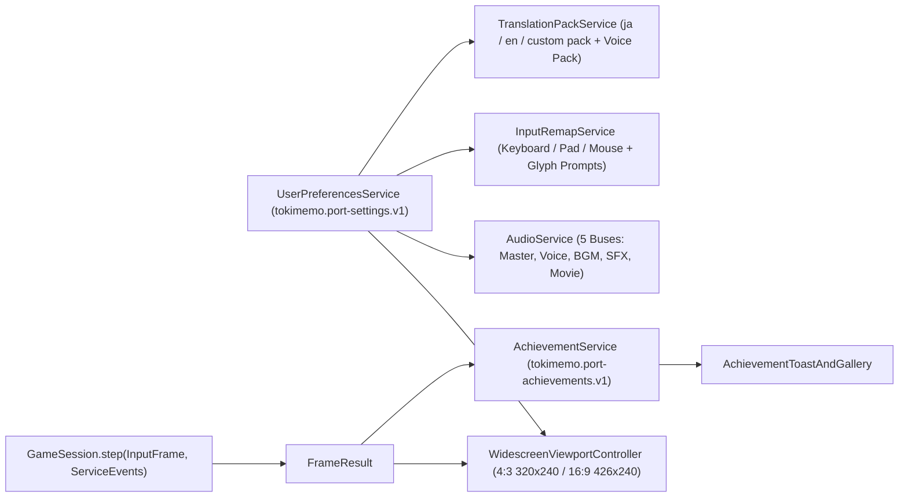

# Phase 4: Modernize the Port

This plan defines the Phase 4 modernization architecture and implementation roadmap for the Godot 4.7.2 native port (`[[phase3]]`), grounded in the source-backed scaling and settings research in `[[widescreen-settings]]` (`[[tickets/T-30005-widescreen-settings-feasibility]]`).

## 1. Baseline and Core Principles

Phases 1, 2, and 3 are complete (`1cf4d1185`):
- **Phase 1 & 2**: All 27 PS1 binaries (`SLPM_86.053` + 26 `.EXN` overlays, 6,952 C functions across 437 logical C basenames, 2,276,920 bytes) build byte-identically and are organized into readable, named domain modules (`[[phase2]]`, `[[spec/phase2-completion-audit]]`).
- **Phase 3**: Complete Japanese Godot 4.7.2 desktop port (`port/godot/`) verified across all 27 `GameMode`s (`326/326` checks in `run_overlay_dispatcher_tests.gd`), 8 multi-heroine 3-year routes (`116/116` checks across `1,216` weeks / `8,496` days in `run_multi_route_playtest_suite.gd`), holiday/date/bomb stress simulation (`670/670` checks across `5,544` invitation trials in `run_holiday_date_bomb_stress_tests.gd`), subgames & event CGs (`267/267` checks in `run_subgames_and_event_cg_playtest.gd`), live desktop boot & 16-bit 22050 Hz PCM `AudioStreamWAV` output (`54/54` checks in `run_live_desktop_full_game_tests.gd`), and `0 / 6,000` tile hotspots across 20 PS1 hardware emulator vs. Godot 320x240 frame comparisons (`tools/port/run_emulator_vs_godot_audit.py`).

Phase 4 modernizes the desktop presentation, user experience, and replayability while obeying four strict invariants:
1. **Zero Simulation Drift**: Widescreen presentation, modern settings, achievements, and player customization must never alter native fixed-point arithmetic (`core/native_math.gd`), native RNG call order (`core/native_rng.gd`), calendar/scheduler state transitions, or `320x240` gameplay collision/hitboxes.
2. **Original-Art Integrity (No Stretching)**: Original `4:3` pixel art, `BUSTUP` portraits, `MDEC` backgrounds, and event CGs must never be stretched horizontally to fill `16:9` or `21:9` viewports. Original `4:3` (`320x240`) remains selectable at any time.
3. **Clean Separation of Native Save vs. Desktop Preferences**: User display, audio-bus, input-remap, accessibility, and language preferences live in a versioned desktop configuration (`tokimemo.port-settings.v1`) separate from PS1 memory-card `OptionConfig` (`stereo_mode`, `voice_enabled`, `mouth_anim_mode`), syncing compatible flags without breaking native save compatibility.
4. **Phase 5 Translation Readiness**: Phase 4 builds and tests the runtime translation-pack and voice-pack selector (`T-30002`) plus expanded widescreen dialogue/choice reflow (`T-30001`) so Phase 5 (`translations/en/` integration and localized UI art) plugs in cleanly without another UI rewrite.

---

## 2. Architecture Overview

### 2.1 Widescreen Presentation & Safe-Frame Apertures (`T-30001`)

As proved in `[[widescreen-settings]]`, Tokimeki Memorial uses three distinct background/scene apertures inside the `320x240` PS1 framebuffer:

| Aperture Class | Native Pixel Geometry | Representative Modes | Widescreen (`16:9` `426x240` / `16:10` / `21:9`) Strategy |
|---|---|---|---|
| **Class A: Weekday Activity Strip** | `320x88` active MDEC strip at `y = 24..111` (`C_01_27.BS`..`C_01_30.BS`, `SCHOOL.NBN` SD sprites clipped to `x = 0..319`) | `0x34` Command Screen, `0x40` School Day, `0x42` Club Practice | Keep the `320x88` strip clipped at `x = 0..319` (so off-screen walk targets `x = -16` and `x = 340` remain hidden); frame the left/right `53px` wings in `426x240` with period-authentic room/notebook pillars and reflow HUD parameter/calendar panels into the wider canvas. |
| **Class B: VN Backdrop + Portrait Stage** | `320x160` upper scene (`y = 0..159`) + `320x80` lower dialogue window (`y = 160..239`); `BUSTUP` portraits up to `160x160` | `0x01` Date, `0x02` Walk-Home (`GEKO`), `0x22` Telephone, Seasonal overlays | Keep the `320x160` backdrop and portrait coordinates centered at `1:1` pixel aspect; render subtle dark/themed side mattes on the `53px` left/right wings; allow the lower dialogue window (`y = 160..239`) and choice cards to expand up to `380px` width in widescreen mode for longer translated lines. |
| **Class C: Full-Screen Plates, Subgames & Event CGs** | Full `320x240` plate or playfield (`TITLE`, `CALROM`, `SCENES`, `ENDING`, `TACO`, `RPG_BAT`, `TAIIKU`, `EN_NICHI`) | `0x10` Title, `0x16` Ending, `0x43..0x5D` Event CGs, Subgames | Center the `320x240` playfield/CG at `1:1` aspect ratio with themed side borders; clamp mouse/pad playfield coordinates (`mouse.c` `12..292` x `12..220`) to the centered `320x240` logical sub-rect while allowing pause/settings overlays to use the full widescreen viewport. |

**Scaling Modes**:
- **Integer Nearest (`Integer Pixel Perfect`)**: Multiplies the logical canvas (`320x240` in `4:3` or `426x240` in `16:9`) by the largest integer factor `k = max(1, min(floor(W / L_w), floor(H / L_h)))` with `CanvasItem.TEXTURE_FILTER_NEAREST` and centers the result.
- **Sharp Nearest Fit (`Aspect Fit Nearest`)**: Scales to fill the window height/width at exact aspect ratio with nearest-neighbor sampling on the logical subviewport.
- **Smooth Linear Fit (`Aspect Fit Linear`)**: Renders the logical canvas crisp at `1x`/`2x` integer resolution, then composites to the display window with `CanvasItem.TEXTURE_FILTER_LINEAR` so pixel edges remain anti-aliased on non-integer displays (e.g. `1366x768`, `1920x1080` for `240p` where `1080 / 240 = 4.5`) without tile-atlas bleeding.

### 2.2 Comprehensive Modern Settings & Localization Selector (`T-30002`)

`UserPreferencesService` manages `user://settings.json` (`schema: "tokimemo.port-settings.v1"`) with five structured tabs in `ModernSettingsMenu`:

1. **Display & Graphics**:
   - Display Mode (`Windowed`, `Borderless Fullscreen`, `Exclusive Fullscreen`), Monitor index, Window size preset (`960x720`, `1280x720`, `1280x960`, `1600x900`, `1920x1080`, `1920x1200`, `2560x1440`).
   - Aspect Mode (`16:9 Widescreen`, `4:3 Original`, `Auto Window Fit`).
   - Scaling Filter (`Integer Nearest`, `Sharp Nearest Fit`, `Smooth Linear`).
   - VSync (`Enabled`, `Disabled`, `Adaptive`) and Max FPS cap (`60`, `120`, `144`, `Uncapped` — affects render interpolation/UI only; `GameSession` logic tick stays locked to the native rational clock).
   - **Safe Display Transaction & Crash Recovery**: Applying any mode/resolution/fullscreen/monitor change starts a `15s` countdown modal (`60s` on first launch) with `Keep Changes` / `Revert` (`ESC`) and writes `pending_display_boot_check = true` before calling `DisplayServer`. If the process exits before confirmation, the next boot restores safe `Windowed 1280x720`.
2. **Audio**:
   - Five independent buses in `AudioServer`: `Master`, `Voice` (`XA`), `BGM` (`SEQ`), `SFX` (`VAB`/UI), and `Movie` (`STR`).
   - Each bus exposes a `0..100%` linear percentage slider converted via `linear_to_db(pct / 100.0)` (`0%` -> `-80 dB` + bus mute) and an explicit mute toggle.
   - Output device selector (`AudioServer.get_output_device_list()`), Stereo/Mono mode (synced with `GameState.option_config.stereo_mode`), Mute-When-Unfocused toggle, and a live "Test Voice / BGM / SFX" audition button.
3. **Controls & Input Remapping**:
   - Full rebinding for Keyboard, Controller (`JoypadButton` / `JoypadMotion`), and Mouse across `confirm`, `cancel`, `menu`, `special`, `shoulder_l`, `shoulder_r`, `start`, `select`, `up`, `down`, `left`, `right`, `quick_save`, `quick_load`, `toggle_aspect`, and `open_settings`.
   - Confirm/Cancel convention toggle (`PS1 Japan: O Confirm / X Cancel` vs. `Western/Modern: Cross/A Confirm / Circle/B Cancel`) with dynamic button-glyph prompt updates across all HUD bars.
   - Analog stick deadzone (`0.10..0.50`), cursor speed, and menu key-repeat delay/rate configuration.
   - Conflict detection modal (swap or reject duplicate bindings within the same action context) and one-click `Reset to Defaults`.
4. **Accessibility & Gameplay QoL**:
   - Text reveal speed (`Slow`, `Normal`, `Fast`, `Instant`), Auto-advance mode and post-line/post-voice delay (`0.5s..5.0s`), Skip mode (`Previously Read` vs. `All Text`).
   - Dialogue/UI font scale (`100%`, `115%`, `130%`, `150%`), Dialogue window backdrop opacity (`50%..100%`), High-contrast text outline toggle, and Screen Flash / Shake reduction (`RPG_BAT`, `TACO`, thunder/lightning scenes).
5. **Language & Voice Pack Selector**:
   - **Text Language / Translation Pack**: Selects between `ja` (Original Japanese native glyph/CP932 presentation), `en` (English translation loaded from `translations/en/returned-v3.jsonl` + `supplemental.jsonl`), or a custom external translation pack directory. Missing or unreviewed unit IDs fall back deterministically to original Japanese without crashing.
   - **Voice Pack**: Independent selector (`ja` Original PS1 `XA` voices vs. custom external voice pack), allowing classic Japanese voices with English text (or future dubbed audio packs).

### 2.3 Deterministic Native Achievement System (`T-30004`)

`AchievementService` observes `(GameState, FrameResult)` after each `GameSession.step()` call:
- **Pure Observer Contract**: Achievement evaluation is strictly read-only. It never mutates `GameState`, never consumes `NativeRng`, and never pauses or delays frame execution.
- **Catalog (`achievement_catalog.gd`)**: 40+ achievements across 5 categories (Story & Calendar Milestones, Heroine Confessions & Endings for all 12 heroines + Yoshio + Solo, Parameter/Exam/Club Mastery, Subgames & Arcade, and Social/Special Challenges such as Bomb Defusal and Popularity Peak).
- **Persistence & Spoiler Protection**: Stored in `user://achievements.json` (`schema: "tokimemo.port-achievements.v1"`). Secret/route-specific achievements mask their title and conditions until unlocked or until the player toggles `Show Spoilers` in the Achievement Gallery overlay.

### 2.4 Gender-Aware Player Customization Stretch Goal (`T-30003`)

Tracked as Milestone `P4.4` (`Backlog`):
- Adds an optional `PlayerCustomizationProfile` (`Default Male`, `Female`, `Custom` pronouns/honorifics/avatar silhouette) at New Game and in settings.
- Adapts first/second-person dialogue tokens, honorific defaults, and translated pronoun placeholders while maintaining explicit, non-destructive fallback policies for original `SCENES`/`ENDING` CGs and voiced `XA` clips.

---

## 3. Milestones and Parallel Execution Order

| Milestone | Ticket | Status | Scope & Exit Condition |
|---|---|---|---|
| **P4.0: Phase 4 Plan & Board Hygiene** | `[[tickets/T-30000-plan-phase4-modernization]]` | **Done** | Phase 3 marked complete in `ROADMAP.md` and `wiki/status.md`; 142 historical tickets closed to `Done`; `wiki/phase4.md` published; `T-30001`, `T-30002`, `T-30004` moved to `Ready`. |
| **P4.1: Widescreen Presentation** | `[[tickets/T-30001-modern-widescreen]]` | **Ready** | `16:9` (`426x240`), `16:10`, and `21:9` aspect-preserved viewport controller, safe-frame aperture framing (`320x88`, `320x160`, `320x240`), widescreen HUD/dialogue reflow, integer/linear scaling filters, `4:3` live toggle, and rendered test suite in Docker. |
| **P4.2: Modern Settings & Pack Selector** | `[[tickets/T-30002-modern-settings]]` | **Ready** | `UserPreferencesService` (`tokimemo.port-settings.v1`), 5-tab `ModernSettingsMenu` (Display with 15s/60s Keep/Revert & crash sentinel, 5-bus Audio, Input Remap with dynamic glyphs, Accessibility, and Language/Voice Pack selector), and service test suite in Docker. |
| **P4.3: Native Achievements** | `[[tickets/T-30004-modern-achievements]]` | **Ready** | 40+ source-grounded achievements in `achievement_catalog.gd`, read-only step-boundary evaluator, atomic `tokimemo.port-achievements.v1` persistence, corner toast UI + spoiler-aware gallery, and deterministic test suite in Docker. |
| **P4.4: Player Customization (Stretch)** | `[[tickets/T-30003-player-customization]]` | **Backlog** | Gender-aware `PlayerCustomizationProfile`, pronoun/honorific token adaptation across Japanese and English script layers, explicit CG/voice fallback policy, and regression suite. |

### Parallel Agent Ownership Packets

`P4.1` (`T-30001`), `P4.2` (`T-30002`), and `P4.3` (`T-30004`) are designed with disjoint file ownership so three agents can execute them in parallel without merge conflicts:

| Packet | Ticket | Exclusive Paths | Shared Integration Boundary |
|---|---|---|---|
| **Packet W (Widescreen)** | `T-30001` | `port/godot/presentation/widescreen_*.gd`, `port/godot/ui/widescreen_hud_layout.gd`, `port/godot/tests/render/run_widescreen_presentation_tests.gd` | Exposes `WidescreenViewportController.apply_display_config(dict)` consumed by `playable_boot.gd` and `UserPreferencesService`. |
| **Packet S (Settings & Packs)** | `T-30002` | `port/godot/services/{user_preferences_service,input_remap_service,translation_pack_service}.gd`, `port/godot/ui/modern_settings_menu.gd`, `port/godot/tests/services/run_modern_settings_tests.gd` | Emits preference-changed notifications consumed by `WidescreenViewportController`, `AudioService`, and `VnScenePresenter`. |
| **Packet A (Achievements)** | `T-30004` | `port/godot/services/achievement_service.gd`, `port/godot/rules/achievement_catalog.gd`, `port/godot/ui/achievement_toast_and_gallery.gd`, `port/godot/tests/services/run_achievement_tests.gd` | Consumes read-only `(GameState, FrameResult)` snapshots after `GameSession.step()`. |

Root serializes final wiring into `port/godot/app/playable_boot.gd` and `port/godot/app/overlay_dispatcher.gd` once the three packets pass their standalone suites and `CODING_STANDARDS.md` reviews.
